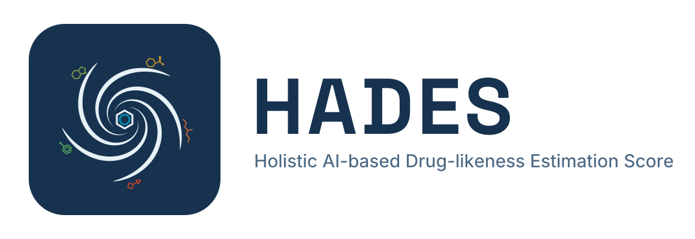

# HADES — Holistic AI-based Drug-likeness Estimation Score

[](https://pypi.org/project/hades-druglikeness/)
[](https://doi.org/10.1021/acs.jcim.5c02953)
[](https://github.com/denovosciencesai/HADES/blob/main/LICENSE)
[](https://github.com/denovosciencesai/HADES/blob/main/environment.yml)
[](#mcp-server-use-hades-from-claude-and-other-ai-assistants)
[](https://github.com/denovosciencesai/HADES/blob/main/docs/mcp.md#claude-code-plugin)

HADES (Holistic AI-based Drug-likeness Estimation Score) is an open-source Python
package, command-line tool and MCP server that predicts the oral drug-likeness of
small molecules from their SMILES strings. It returns a score from 0 to 1, a
data-driven complement to QED and Lipinski's rule of five, for ranking and
filtering compounds in drug discovery, virtual screening and medicinal chemistry.
The score is the mean predicted probability of a soft-voting ensemble of five
machine-learning classifiers (HistGradientBoosting, RandomForest, CatBoost,
XGBoost and LightGBM) trained on Mordred, ADMET-AI and QED descriptors.

This repository is the authors' implementation of
[Petrosyan et al., *J. Chem. Inf. Model.* 2026, 66 (16), 9944–9960](https://doi.org/10.1021/acs.jcim.5c02953).
It ships the paper's pretrained models and lets you:

- score molecules from Python or the command line (CSV in, CSV out);
- score them from Claude Code, Claude Desktop or any other MCP client, through the
  bundled MCP server and Claude Code plugin;
- train a new HADES ensemble on your own labelled compounds.

**Contents:** [Quick start](#quick-start) ·
[Installation](#installation) ·
[Scoring](#score-molecules) ·
[Training](#train-your-own-model) ·
[MCP and Claude](#mcp-server-use-hades-from-claude-and-other-ai-assistants) ·
[Model integrity](#model-files-and-integrity) ·
[How to cite](#how-to-cite) ·
[FAQ](#faq)

## Quick start

Installing HADES downloads about 3 GB and takes 10–20 minutes the first time.
After that, scoring is about 30 ms per molecule, once the models have loaded.

In a Python 3.10 environment (on Linux, add the CPU-only torch index from
[Installation](#with-pip) to save several GB):

```bash
pip install hades-druglikeness
```

```python
from HADES_CALCULATOR import HADES_score

hades = HADES_score()             # loads the models; ~30 s, once per process
hades.score("CCO")                # 0.0178...
hades.score(["CCO", "c1ccccc1"])  # DataFrame with SMILES and HADES_Score columns
```

To score a CSV, run `hades-score -i molecules.csv -o scores.csv`, which adds a
`HADES_Score` column. To use HADES from Claude, see
[MCP server](#mcp-server-use-hades-from-claude-and-other-ai-assistants); to run
the scripts on this repository's example data, or to train, see
[With conda, from a clone](#with-conda-from-a-clone).

### How it works

Each SMILES is standardized (common counter-ions stripped, charges neutralized,
stereochemistry removed) and described by 298 molecular descriptors: Mordred
descriptors, ADMET properties predicted by ADMET-AI, and six of the eight
properties behind QED. Each of the five classifiers predicts the probability that
the molecule belongs with the approved oral drugs, and the HADES score is the mean
of the five.

The shipped models come from the paper's dataset of 8,106 compounds, 1,488
approved oral drugs and 6,618 non-drug molecules, split 80/20 into the training
and test sets in `train_test_saved/`.

## Installation

HADES needs Python 3.10. It runs on Linux, Windows and Apple Silicon Macs, with
the same scores on all three. Intel Macs are not supported: torch 2.5.1, which
HADES pins, has no build for them.

### With pip

HADES is on PyPI as `hades-druglikeness`. In a Python 3.10 environment:

```bash
pip install hades-druglikeness
```

On Linux, add PyTorch's CPU-only index, or pip downloads several GB of CUDA
libraries that HADES does not use; the scores are identical either way:

```bash
pip install --extra-index-url https://download.pytorch.org/whl/cpu hades-druglikeness
```

The trained models are installed with the code. `from HADES import HADES_score, HADESTrainer`
works from any directory, as do the commands `hades-score` and `hades-train`
(the same options as `python HADES_CALCULATOR.py` and `python train_your_HADES.py`).
For the [MCP server](#mcp-server-use-hades-from-claude-and-other-ai-assistants),
install `"hades-druglikeness[mcp]"` instead, which adds the `hades-mcp` command.

### With conda, from a clone

The conda environment is the contributor and reproduction path: it is what CI
builds, what [CONTRIBUTING.md](CONTRIBUTING.md) sets up, and the environment to
train in. Scoring does not need it — the models ship inside the package, so
[With pip](#with-pip) above is enough. Use conda to run the scripts and example
data in this repository, or to reproduce the paper; RDKit and the other compiled
dependencies install most reliably from conda-forge:

```bash
conda env create -f environment.yml
conda activate hades
```

That installs Python 3.10, RDKit and every pinned package in `requirements.txt`.
Optionally, install the project into the environment as well:

```bash
pip install -e .
```

That adds the same imports and commands as [With pip](#with-pip), built from the
clone's source rather than from PyPI.

**Using HADES from Claude or another AI assistant?** After this, follow
[MCP server](#mcp-server-use-hades-from-claude-and-other-ai-assistants) to add
the MCP SDK and connect it.

## Score molecules

In Python, `score()` returns a float for one SMILES and a DataFrame (columns
`SMILES`, `HADES_Score`) for a list:

```python
from HADES_CALCULATOR import HADES_score

hades = HADES_score()
hades.score(["CCCC", "NOT_A_SMILES", "CCO"])
# Could not calculate 1 SMILES: ['NOT_A_SMILES']
#    SMILES  HADES_Score
#      CCCC     0.000458
#       CCO     0.017847
```

A list skips what RDKit cannot parse, scores the rest and says what it skipped,
so the DataFrame can be shorter than the input. A single unparseable SMILES
raises `ValueError` instead. Library log messages are silenced by default;
`HADES_score(quiet=False)` brings them back.

From the command line, score a CSV and get it back with a `HADES_Score` column:

```bash
python HADES_CALCULATOR.py -i data_to_test.csv -o output.csv --smiles-col SMILES
```

Every input row is kept, in order. Rows whose SMILES cannot be parsed, or is
empty, get an empty `HADES_Score`, and the run prints which ones they were.

## Train your own model

Given a CSV of molecules labelled positive and negative, train a new ensemble:

```bash
python train_your_HADES.py -i data_to_test.csv -o my_model \
    --smiles-col SMILES --label-col phase --positive-label 4 --negative-label 0
```

```python
from train_your_HADES import HADESTrainer

HADESTrainer(output_dir="my_model", smiles_col="SMILES", label_col="phase",
             positive_label=4, negative_label=0).run("data_to_test.csv")
```

Expect at least 15 minutes even on a few molecules: feature selection has a large
fixed cost. The run writes its models, data splits and settings into `my_model/`,
and refuses to overwrite an existing folder unless you pass `--overwrite`.
[docs/training.md](https://github.com/denovosciencesai/HADES/blob/main/docs/training.md) has the timings, the output layout,
retraining with `--reuse-hpo` and custom hyperparameter searches.

### Score with a model you trained

Point HADES at the run's models and its training parquet:

```bash
python HADES_CALCULATOR.py --models-dir my_model/models --x-train my_model/X_train.parquet -i data_to_test.csv -o scores.csv
```

```python
custom_hades = HADES_score(models_dir="my_model/models", x_train_parquet="my_model/X_train.parquet")
```

## MCP server: use HADES from Claude and other AI assistants

`hades_mcp.py` is a cheminformatics MCP server: it serves HADES over the
[Model Context Protocol](https://modelcontextprotocol.io), so Claude and other AI assistants can score molecules while they work. It exposes
one tool, `hades_score`, which takes a list of SMILES and returns a score for each,
plus a reason for every input it could not score. Scoring runs on your machine.
Pick one of the ways below; each ends with the server registered in Claude Code.

**With pip.** Install HADES with the `mcp` extra, then register its `hades-mcp`
command by its full path:

```bash
pip install "hades-druglikeness[mcp]"
claude mcp add --scope user hades -- "$(which hades-mcp)"
```

On Windows, give the path that `where hades-mcp` prints instead of `$(which hades-mcp)`.

**With uvx, no environment to manage.** [uv](https://docs.astral.sh/uv/) installs
HADES from PyPI into a cached environment and runs the server from it. Run it once
in a terminal first: the first run downloads about 3 GB and can take 15 minutes
or more, far longer than an MCP client waits for a server to start. Then register it:

```bash
uvx --python 3.10 --from "hades-druglikeness[mcp]" hades-mcp --selftest
claude mcp add --scope user hades -- uvx --python 3.10 --from "hades-druglikeness[mcp]" hades-mcp
```

On Linux, add `--extra-index-url https://download.pytorch.org/whl/cpu --index-strategy unsafe-best-match`
after `uvx` in **both** commands, to get the CPU-only torch; without it, the first run
pulls CUDA libraries HADES does not use and needs about 6.5 GB. Both, because uv
caches one environment per resolution: the index settings are part of that
resolution, so a warm-up that carries them and a registered server that does not
(or the reverse) use different environments. The warm-up then fills one and
leaves the server installing from scratch on first start, which is the wait it
was run to avoid. See
[docs/mcp.md](https://github.com/denovosciencesai/HADES/blob/main/docs/mcp.md#without-a-clone).

**With the Claude Code plugin, nothing to configure.** The simplest route. The
plugin runs the same `uvx` command as above, so it needs [uv](https://docs.astral.sh/uv/)
on your `PATH` and nothing else: no conda environment, no interpreter path. It
passes the CPU-only torch index itself, on every platform.

Run the warm-up once in a terminal first — the plugin cannot wait 15 minutes for
a first install any more than `claude mcp add` can. uv caches an environment per
resolution, so run **exactly** the command the plugin runs, pin and index
settings included; a warm-up that differs in any of them fills a different cache
entry and leaves the plugin to install from scratch anyway:

```bash
UV_EXTRA_INDEX_URL=https://download.pytorch.org/whl/cpu \
UV_INDEX_STRATEGY=unsafe-best-match \
uvx --python 3.10 --from "hades-druglikeness[mcp]==0.9.1" hades-mcp --selftest
```

In PowerShell:

```powershell
$env:UV_EXTRA_INDEX_URL = "https://download.pytorch.org/whl/cpu"
$env:UV_INDEX_STRATEGY = "unsafe-best-match"
uvx --python 3.10 --from "hades-druglikeness[mcp]==0.9.1" hades-mcp --selftest
```

It prints a score for ethanol (`0.0178  CCO`). Then:

```
/plugin marketplace add denovosciencesai/HADES
/plugin install hades@denovo-hades
```

The version in that command is the one the plugin pins; it matches the plugin
release, not necessarily the newest HADES on PyPI.

**From a clone.** In the [conda environment](#with-conda-from-a-clone), add the
MCP SDK, then register the clone's `hades_mcp.py` with that environment's Python
(replace both paths with your own):

```bash
pip install "mcp==2.3.0"
claude mcp add --scope user hades -- /home/you/miniconda3/envs/hades/bin/python /home/you/HADES/hades_mcp.py
```

**Hosted, nothing to install.** Denovo Sciences runs HADES as a remote MCP
server at `https://hades.denovosciences.ai/mcp`, for clients that cannot start a
local process — Claude in a browser, and on mobile. Add it as a custom
connector. Scoring then happens on our servers rather than on your machine, so
the molecules you send leave it:
see [docs/privacy.md](https://github.com/denovosciencesai/HADES/blob/main/docs/privacy.md).
To run the same container inside your own network instead, see
[deploy/README.md](https://github.com/denovosciencesai/HADES/blob/main/deploy/README.md).

Check it with `/mcp`, then ask Claude for the HADES score of a molecule.
[docs/mcp.md](https://github.com/denovosciencesai/HADES/blob/main/docs/mcp.md) covers installing from a shell or a local clone, Claude
Desktop and other clients, Windows and WSL, the tool's output and its configuration.

## Model files and integrity

The pretrained models are Python pickles, and **unpickling a file executes code
contained in it**: only load models from this repository or from a training run
of your own. `HADES_score` checks the shipped models against
`HADES/data/models/SHA256SUMS` before loading them, and refuses to load a file
that does not match. [docs/model-integrity.md](https://github.com/denovosciencesai/HADES/blob/main/docs/model-integrity.md) lists the
checksums and the `verify=` options, and shows how to add a manifest to your own
models.

## How to cite

If you use HADES, please cite the paper:

> Petrosyan, N.; Matevosyan, H.; Tirosyan, I.; Gabrielyan, Y.; Gevorgyan, S.;
> Harutyunyan, V.; Matevosyan, M.; Zakaryan, H. Machine Learning-Based Soft Voting
> Ensemble Model for the Prediction of Oral Drug-Likeness of Chemical Structures.
> *J. Chem. Inf. Model.* **2026**, *66* (16), 9944–9960.
> <https://doi.org/10.1021/acs.jcim.5c02953>

```bibtex
@article{petrosyan2026hades,
  title   = {Machine Learning-Based Soft Voting Ensemble Model for the Prediction of Oral Drug-Likeness of Chemical Structures},
  author  = {Petrosyan, Narek and Matevosyan, Hovhannes and Tirosyan, Irina and Gabrielyan, Yeva and Gevorgyan, Smbat and Harutyunyan, Vardan and Matevosyan, Mher and Zakaryan, Hovakim},
  journal = {Journal of Chemical Information and Modeling},
  volume  = {66},
  number  = {16},
  pages   = {9944--9960},
  year    = {2026},
  doi     = {10.1021/acs.jcim.5c02953}
}
```

GitHub's **Cite this repository** button, generated from `CITATION.cff`, gives the
same reference in APA and BibTeX.

## FAQ

**What does a HADES score mean?**
It is a number between 0 and 1: the mean probability, across the five models,
that a molecule belongs with the approved oral drugs HADES was trained on. Higher
means more similar to approved oral drugs. Use it to rank and prioritize
compounds; it is not a probability that a compound will succeed in the clinic.

**How is HADES different from QED or Lipinski's rule of five?**
The rule of five and QED judge a molecule from a few physicochemical properties,
through fixed cutoffs or desirability functions. HADES is trained on data: it uses
most of QED's properties together with Mordred descriptors and ADMET-AI
predictions, in models fitted to separate approved oral drugs from non-drug
molecules. See the paper for how it compares with other drug-likeness scores.

**Which molecules can HADES score (salts, fragments, invalid SMILES)?**
Whole molecules that RDKit can parse. The counter-ions on RDKit's default salt
list (Na+, K+, Cl-, mesylate, tartrate and other common ones) are stripped and
charges neutralized first, so those salt forms score as their parent molecule.
Others, such as citrate, besylate or succinate, stay attached, as does the second
copy of the parent in a 2:1 salt, and they change the score: to score a drug,
pass its parent compound (free acid or base). Empty inputs and fragments with
attachment points (`*`) are rejected rather than scored; the MCP server also
rejects inputs that salt stripping leaves empty, such as sodium chloride or
water. Scores mean most for drug-sized organic molecules like the ones in the
training data; a low score for chemistry far outside it is not evidence that a
molecule is not drug-like.

**How fast is HADES?**
After the models load, about 30 ms per molecule on a laptop CPU (an Intel Core 5
120U: 200 compounds in 5.6 s, 2,000 in 60.4 s), so 10,000 molecules take about
five minutes. Training is much slower; see [docs/training.md](https://github.com/denovosciencesai/HADES/blob/main/docs/training.md).

**Can I use HADES commercially?**
Yes. HADES is released under the MIT license, which allows commercial use; see
[LICENSE](https://github.com/denovosciencesai/HADES/blob/main/LICENSE).

## Contributing

[CONTRIBUTING.md](https://github.com/denovosciencesai/HADES/blob/main/CONTRIBUTING.md) covers setting up, the repository layout,
running the tests and submitting changes. To report a security problem, follow
[SECURITY.md](https://github.com/denovosciencesai/HADES/blob/main/SECURITY.md).

## License

MIT. See [LICENSE](https://github.com/denovosciencesai/HADES/blob/main/LICENSE).

HADES is developed and maintained by
[Denovo Sciences](https://denovosciences.ai), the authors of the paper above.
